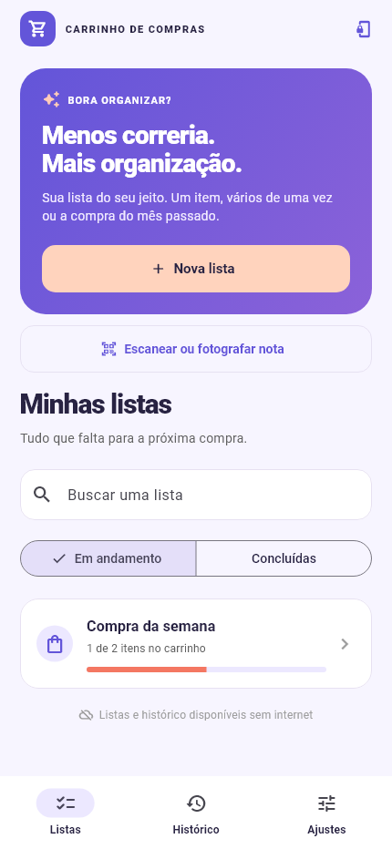
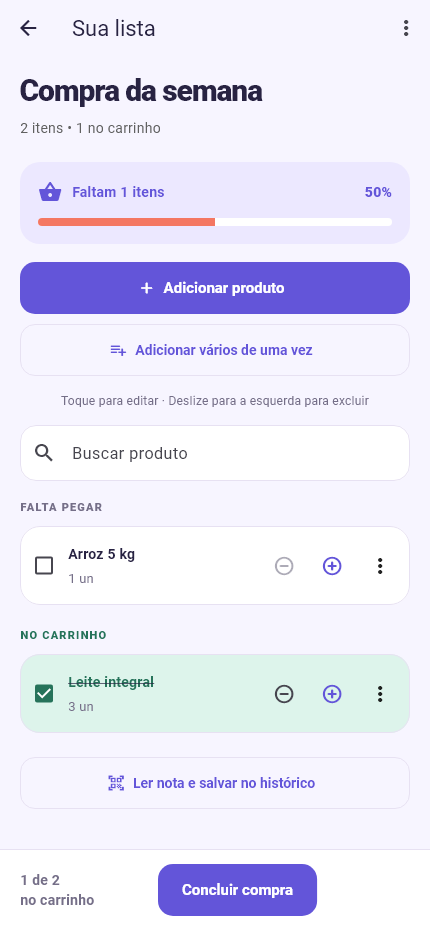
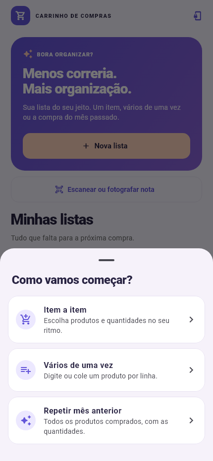
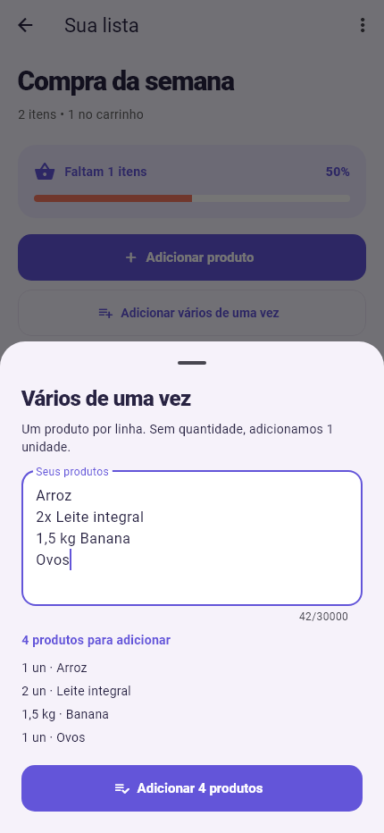
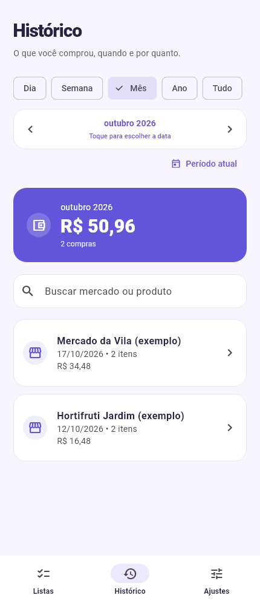
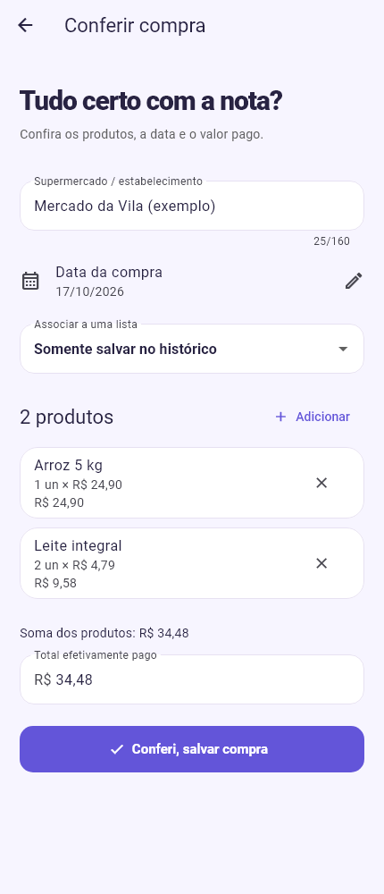
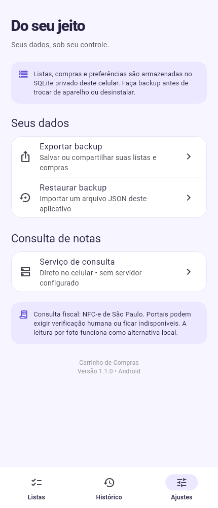

<div align="center">


# Carrinho de Compras

**Planeje sua compra. Organize o carrinho. Acompanhe seu histórico.**

Listas de supermercado sem preços no planejamento, notas fiscais conferidas e compras organizadas por período — tudo em português e com os dados no celular.

**Android 7.0+ · Versão 1.1.0 · Flutter · SQLite · Sem cadastro**

### [Baixar o APK para testar](https://github.com/PedroHda/CarrinhoDeCompras/releases/download/v1.1.0/carrinho-de-compras-1.1.0-teste.apk)

[Ver a release e os arquivos](https://github.com/PedroHda/CarrinhoDeCompras/releases/tag/v1.1.0) · [Baixar o código em ZIP](https://github.com/PedroHda/CarrinhoDeCompras/archive/refs/heads/master.zip) · [Todas as versões](https://github.com/PedroHda/CarrinhoDeCompras/releases)

</div>

O download recomendado instala o **Carrinho Teste**, uma cópia que pode ficar ao lado do aplicativo atual. Para usar suas listas e compras nessa cópia, transfira um backup pelos **Ajustes**. [Entenda os instaladores](#instalar).

**Neste guia:** [Instalação](#instalar) · [Imagens](#imagens) · [Como usar](#usar) · [Backup](#backup) · [Código-fonte](#codigo) · [Executar](#executar) · [Compilar](#compilar) · [Backend](#backend) · [Dúvidas](#duvidas)

## O que você pode fazer

| Recurso | Como ajuda na compra |
|---|---|
| **Três formas de montar a lista** | Adicione item a item, cole vários produtos por texto ou repita as compras do mês anterior. |
| **Planejamento sem preços** | A lista mostra produtos, unidades, quantidades e progresso. Os valores ficam na conferência e no histórico. |
| **Edição rápida** | Toque para editar, ajuste a quantidade pelos botões, marque o que pegou e exclua por deslize com **Desfazer**. |
| **Leitura de notas** | Consulte o QR code de uma NFC-e de São Paulo ou reconheça o texto de uma foto no celular. |
| **Histórico por período** | Consulte dia, semana, mês, ano ou todo o histórico e busque por mercado ou produto. |
| **Dados no aparelho** | Listas e compras ficam em um banco local. Exporte um backup para guardar uma cópia ou trocar de celular. |

<a id="instalar"></a>
## Instalar no Android

### 1. Escolha o instalador

| Download | Quando escolher | Nome no celular |
|---|---|---|
| **[APK de teste separado — recomendado](https://github.com/PedroHda/CarrinhoDeCompras/releases/download/v1.1.0/carrinho-de-compras-1.1.0-teste.apk)** | Para testar a versão nova preservando a instalação atual. | **Carrinho Teste** |
| [APK com o identificador original](https://github.com/PedroHda/CarrinhoDeCompras/releases/download/v1.1.0/carrinho-de-compras-1.1.0.apk) | Para uma instalação nova usando o pacote original do aplicativo. | **Carrinho de Compras** |

Os dois arquivos contêm os mesmos recursos e exigem **Android 7.0 ou superior**. Cada download tem aproximadamente **106 MB (101 MiB)** e atende a aparelhos ARM de 32/64 bits e x86_64. Não é necessário instalar Flutter, Expo, .NET ou criar uma conta para usar o APK.

> **Já usa a versão 1.0.0?** Escolha **Carrinho Teste**. O APK com identificador original desta entrega tem uma assinatura diferente da versão 1.0.0 publicada e **não a atualiza diretamente**. A chave antiga não estava disponível no ambiente de compilação. Preserve um backup antes de qualquer reinstalação; a cópia de teste dispensa desinstalar o app anterior.

### 2. Baixe e instale

1. Abra este README no celular e toque no **APK de teste separado**.
2. Aguarde o download do arquivo `.apk`. Você também pode baixar pelo computador e transferir o arquivo para o celular.
3. Abra o arquivo pela notificação de download ou pelo aplicativo **Arquivos / Downloads**.
4. Se o Android solicitar autorização, permita a instalação para o navegador ou gerenciador de arquivos que está abrindo o APK. O nome dessa opção varia conforme o aparelho.
5. Toque em **Instalar** e depois em **Abrir**. Procure por **Carrinho Teste** na lista de aplicativos.
6. Para trazer os dados do app anterior, siga o [passo a passo do backup](#backup).

Baixe os arquivos pela [release deste repositório](https://github.com/PedroHda/CarrinhoDeCompras/releases/tag/v1.1.0). Os instaladores são builds de teste em modo release, assinados com chave de desenvolvimento, distribuídos diretamente pelo GitHub.

<details>
<summary><strong>Conferir a integridade do download</strong></summary>

Na mesma release estão os arquivos `SHA256-teste.txt`, `SHA256.txt` e `VALIDACAO.md`. Compare o hash do APK com o arquivo correspondente.

No Windows, abra o PowerShell na pasta do download:

```powershell
Get-FileHash .\carrinho-de-compras-1.1.0-teste.apk -Algorithm SHA256
```

O resultado deve ser igual ao conteúdo de `SHA256-teste.txt`, ignorando maiúsculas e minúsculas. Para o APK original, use seu nome de arquivo e compare com `SHA256.txt`.

</details>

<a id="imagens"></a>
## O aplicativo em imagens

<table>
  <tr>
    <th>Minhas listas</th>
    <th>Produtos e progresso</th>
    <th>Três formas de começar</th>
  </tr>
  <tr>
    <td><a href="docs/screenshots/listas.png"></a></td>
    <td><a href="docs/screenshots/lista-aberta.png"></a></td>
    <td><a href="docs/screenshots/criar-lista.png"></a></td>
  </tr>
  <tr>
    <th>Entrada por texto</th>
    <th>Histórico por período</th>
    <th>Conferência da compra</th>
  </tr>
  <tr>
    <td><a href="docs/screenshots/entrada-em-lote.png"></a></td>
    <td><a href="docs/screenshots/historico.png"></a></td>
    <td><a href="docs/screenshots/conferir-compra.png"></a></td>
  </tr>
</table>

Toque em uma imagem para abrir em tamanho maior. São **renderizações dos componentes reais do aplicativo com dados fictícios**, produzidas para a documentação; não são fotografias de um aparelho físico nem dados de usuários.

<a id="usar"></a>
## Como usar

### Seu primeiro teste em poucos passos

1. Na aba **Listas**, toque em **Nova lista**.
2. Escolha **Vários de uma vez** e dê um nome, como `Compra da semana`.
3. Cole o exemplo abaixo e confira a prévia.
4. Toque em **Adicionar 5 produtos**.
5. Na lista aberta, marque os produtos que já colocou no carrinho. Toque no nome para editar ou deslize para a esquerda para excluir.
6. Ao terminar a compra, leia a nota ou use **Concluir compra** para fazer a conferência manual. Depois de salvar, consulte a aba **Histórico**.

```text
Arroz 5 kg
2x Leite integral
1,5 kg Banana
500 g Café
1 cx Ovos
```

### Montar uma lista de três maneiras

#### Item a item

Em **Nova lista → Item a item**, informe o nome da lista. Depois toque em **Adicionar produto**, preencha o produto, a quantidade e a unidade e salve. Repita para cada item. Nenhum preço é solicitado no planejamento.

#### Vários de uma vez

Em **Nova lista → Vários de uma vez**, informe o nome e digite ou cole **um produto por linha**. Também é possível acrescentar um lote a uma lista existente pelo botão **Adicionar vários de uma vez**.

| Texto digitado | O que entra na lista |
|---|---|
| `Leite integral` | Leite integral, **1 un**. |
| `2x Leite integral` | Leite integral, **2 un**. |
| `1,5 kg Banana` | Banana, **1,5 kg**. |
| `500 g Café` | Café, **500 g**. |
| `1 cx Ovos` | Ovos, **1 cx**. |
| `Arroz 5 kg` | Produto chamado “Arroz 5 kg”, **1 un** — um pacote de 5 kg. |

Use **Enter** entre os produtos. A sequência literal `\n` também é aceita; `/n`, vírgulas e ponto e vírgula não separam itens. Linhas vazias são ignoradas. Quando não há uma quantidade explícita no início, entra **1 unidade**. Para indicar unidades com o multiplicador, mantenha o espaço: `2x Leite`.

A prévia mostra a interpretação antes de gravar. O lote admite até **2.000 produtos**, com até **160 caracteres** por nome. Linhas repetidas entram como itens separados.

#### Repetir mês anterior

Em **Nova lista → Repetir mês anterior**, confira ou altere o nome sugerido e salve. O aplicativo reúne os produtos de **todas as compras salvas no mês calendário anterior ao atual**, usando a data da compra.

Exemplo: se você criar a lista em outubro, a base será o histórico de setembro — não os últimos 30 dias.

| Compras registradas no mês anterior | Nova lista |
|---|---|
| Leite: 2 un em uma compra e 3 un em outra | Leite: **5 un**. |
| Banana: 1 kg e depois 0,5 kg | Banana: **1,5 kg**. |
| Queijo: 1 kg e 500 g | **Dois itens**, um em kg e outro em g. |

Descrições iguais são agrupadas ignorando maiúsculas, minúsculas e espaços repetidos, desde que a unidade também seja igual. O app não converte unidades nem tenta associar nomes diferentes, marcas ou sinônimos. A nova lista começa **sem preços e com todos os itens desmarcados**; as compras originais continuam no histórico.

Se não houver compras salvas no mês anterior, o aplicativo informa isso e não cria uma lista vazia.

### Manipular os produtos durante a compra

| Ação | Como fazer |
|---|---|
| Marcar o que já pegou | Toque na caixa ao lado do produto. Ele passa para **No carrinho**. |
| Corrigir nome, quantidade ou unidade | Toque no nome do produto ou use o menu **Editar**. |
| Ajustar a quantidade rapidamente | Use **+ / −**. Em kg/l/lt, o passo é 0,1; nas demais unidades, é 1. Para outro valor, abra a edição. |
| Excluir um produto | Deslize para a esquerda ou use o menu **Excluir**. |
| Recuperar uma exclusão | Toque em **Desfazer** na mensagem exibida logo após remover o item. |
| Encontrar um produto | Use **Buscar produto** dentro da lista. |
| Renomear, duplicar ou excluir a lista | Abra o menu de três pontos no topo da lista. |

Listas concluídas ficam na seção **Concluídas**, disponíveis para consulta e duplicação. Uma cópia preserva os produtos e as quantidades e começa com os itens desmarcados e os preços zerados.

### Ler e salvar uma nota fiscal

Na tela inicial, toque em **Escanear ou fotografar nota**. Dentro de uma lista, use **Ler nota e salvar no histórico**.

| Opção | Uso |
|---|---|
| **QR code pela câmera** | Aponte para o QR da nota. A consulta pela internet atende NFC-e de São Paulo. |
| **Fotografar e ler produtos** | Fotografe a nota inteira, bem iluminada e sem inclinação. O texto é reconhecido localmente. |
| **Importar foto da galeria** | Escolha uma foto da nota que já está no celular. |
| **Colar endereço do QR code** | Cole o endereço completo contido no QR, com todos os parâmetros. Uma chave isolada de 44 dígitos não substitui esse endereço. |

Após a leitura:

1. Confira o estabelecimento e a **data da compra**.
2. Revise produtos, quantidades, unidades, preços e totais. Toque em uma linha para corrigir e use **Adicionar** se faltar algum produto.
3. Confira o **Total efetivamente pago**, incluindo descontos e ajustes da nota.
4. Escolha uma lista para associar ou mantenha **Somente salvar no histórico**.
5. Toque em **Conferi, salvar compra**. A compra entra no histórico; se houver uma lista associada, ela será marcada como concluída.

A leitura por foto pode confundir ou omitir informações, por isso a conferência faz parte do fluxo. Se a data não for reconhecida, corrija a data sugerida antes de salvar. Uma NFC-e com chave fiscal já registrada não pode ser importada novamente; compras sem chave reconhecida exigem atenção para evitar duplicação manual.

### Concluir uma compra manualmente

Marque os produtos comprados e toque em **Concluir compra**. **Somente os itens marcados** seguem para a conferência. Informe o estabelecimento, confirme a data e preencha os valores efetivamente pagos antes de salvar.

Os preços aparecem nessa conferência e no histórico, enquanto a lista de planejamento continua sem valores. Salvar a compra conclui a lista associada.

### Consultar o histórico

Abra a aba **Histórico** e escolha **Dia**, **Semana**, **Mês**, **Ano** ou **Tudo**.

- Use as setas para voltar ou avançar um período.
- Toque na data para escolher uma referência no calendário.
- Use **Período atual** para voltar à data atual.
- Busque pelo nome do mercado ou pela descrição de um produto.
- Toque em uma compra para ver os produtos, quantidades e valores pagos.

Os filtros consideram a **data da compra, no calendário local do celular**, e a semana vai de **segunda a domingo**. O total mostrado corresponde às compras visíveis após aplicar o período **e a busca**.

Excluir uma lista preserva as compras já registradas no histórico. Excluir uma compra pelo histórico preserva a lista original.

<a id="backup"></a>
## Backup e troca de aparelho



### Guardar uma cópia dos dados

1. Abra **Ajustes → Exportar backup**.
2. No compartilhamento do Android, escolha onde salvar ou enviar o arquivo `.json`.
3. Confirme que o arquivo ficou guardado fora do app, em um local que você consiga acessar depois.

O backup contém **listas e compras**, com seus produtos, quantidades e valores históricos. Ele não inclui as fotos das notas nem as preferências do serviço de consulta.

### Restaurar no Carrinho Teste ou em outro celular

1. Instale e abra o aplicativo de destino.
2. Deixe o arquivo de backup acessível nesse celular.
3. Entre em **Ajustes → Restaurar backup** e escolha o `.json` exportado pelo app.
4. Confira a mensagem de confirmação e toque em **Restaurar**.

> A restauração **substitui todas as listas e compras do aplicativo de destino**; ela não mescla os dados. Exporte uma cópia antes se quiser preservar o conteúdo atual. São aceitos backups compatíveis de até **5 MB**. Se a restauração falhar, a transação preserva os dados anteriores.

O aplicativo não faz sincronização automática entre celulares e não depende de backup automático do Android. Faça uma exportação antes de trocar de aparelho, desinstalar ou limpar os dados do app.

## Conexão, dados e permissões

| Recurso | Precisa de internet? | Observação |
|---|---|---|
| Criar/editar listas e consultar o histórico local | Não | Os dados salvos ficam no aparelho. |
| Gerar lista com as compras do mês anterior | Não | Usa as compras já registradas no banco local. |
| Reconhecer texto de uma foto | Não, para o processamento OCR | A foto é processada no celular e os resultados passam por conferência. |
| Consultar uma NFC-e pelo QR/endereço | Sim | Acessa o portal fiscal diretamente ou o backend escolhido. |
| Enviar um backup para um serviço de nuvem | Depende do destino | O compartilhamento e a conta de destino são escolhidos por você. |

A câmera é usada para escanear e fotografar notas. Listas e histórico continuam disponíveis sem conceder essa permissão. O banco SQLite fica no armazenamento privado do aplicativo, sem conta ou sincronização automática. Os backups exportados são arquivos JSON legíveis, sem criptografia própria; guarde-os em um local privado.

<a id="codigo"></a>
## Baixar o código-fonte

### Com Git

Instale o [Git](https://git-scm.com/downloads/) e execute no terminal, dentro da pasta onde deseja guardar o projeto:

```bash
git clone https://github.com/PedroHda/CarrinhoDeCompras.git
cd CarrinhoDeCompras
```

### Sem Git

1. [Baixe o código em ZIP](https://github.com/PedroHda/CarrinhoDeCompras/archive/refs/heads/master.zip), ou abra o botão **Code → Download ZIP** no GitHub.
2. Extraia o arquivo e abra a pasta do projeto no seu editor.

O ZIP da branch `master` contém o código mais recente. Para consultar exatamente a versão publicada, abra a [tag v1.1.0](https://github.com/PedroHda/CarrinhoDeCompras/tree/v1.1.0).

**O APK não vem dentro do clone nem do ZIP.** Os instaladores ficam nas [releases](https://github.com/PedroHda/CarrinhoDeCompras/releases), enquanto o Git guarda o código, as imagens, os checksums e a documentação.

### Onde está cada parte

```text
CarrinhoDeCompras/
├── mobile/                 Aplicativo Android atual, em Flutter/Dart
│   ├── lib/core/           Formatação de valores e quantidades
│   ├── lib/domain/         Modelos, períodos e interpretação de listas
│   ├── lib/data/           SQLite, notas fiscais, OCR e backups
│   ├── lib/ui/             Telas, formulários, tema e estado
│   ├── test/               Testes de regras, persistência e interface
│   └── android/            Configuração e integração nativa Android
├── backend/                API ASP.NET Core opcional e seus testes
├── scripts/                Compilação, execução e documentação
├── artifacts/              Checksums e relatório de validação da entrega
├── docs/                   Relatórios técnicos e imagens
└── carrinho-de-compras/     Protótipo Expo anterior, preservado
```

Para trabalhar no app distribuído por este README, use **`mobile/`**. A pasta `carrinho-de-compras/` é um protótipo anterior e não participa da compilação Flutter; não é necessário usar npm ou Expo para executar o aplicativo atual.

<a id="executar"></a>
## Preparar o ambiente e executar

### Requisitos de desenvolvimento

| Ferramenta | Referência validada para a versão 1.1.0 |
|---|---|
| Flutter | **3.47.7**, incluindo Dart **3.13.5**. |
| Android SDK | API/Build Tools **36**, Platform Tools e Command-line Tools. |
| Java | **JDK 21** no ambiente de compilação; bytecode Java/Kotlin 17. |
| NDK | **28.2.13676358**. |
| CMake | **3.22.1**, utilizado na compilação Android. |
| Dispositivo | Celular Android 7.0+ com depuração USB ou emulador Android configurado. |
| .NET | [**SDK 10**](https://dotnet.microsoft.com/en-us/download/dotnet/10.0), somente para executar/testar o backend opcional. |

Use os guias oficiais de [instalação do Flutter](https://docs.flutter.dev/install) e [configuração do ambiente Android](https://docs.flutter.dev/platform-integration/android/setup). O Dart vem com o Flutter; as dependências exatas do projeto estão em [`mobile/pubspec.lock`](mobile/pubspec.lock).

Na primeira preparação, confira o ambiente e aceite as licenças necessárias:

```bash
flutter doctor
flutter doctor --android-licenses
flutter devices
```

Com o terminal na raiz do repositório:

```bash
cd mobile
flutter pub get
flutter run
```

Se houver mais de um dispositivo, use `flutter run -d ID_DO_DISPOSITIVO`, substituindo o identificador pelo que aparece em `flutter devices`. No celular físico, ative a depuração USB e autorize a conexão com o computador. O app inicia em consulta fiscal direta; não precisa de um servidor local para abrir ou usar as listas.

<a id="compilar"></a>
## Compilar seu próprio APK

### Windows: script de compilação

Na **raiz do repositório**, execute no PowerShell:

```powershell
# Confere ferramentas e versões, sem compilar.
.\scripts\build-apk.ps1 -PreflightOnly

# Gera Carrinho Teste, para instalar ao lado do app atual.
.\scripts\build-apk.ps1 -SideBySideTest
```

Saídas da versão atual:

```text
artifacts/carrinho-de-compras-1.1.0-teste.apk
artifacts/SHA256-teste.txt
```

Para gerar o APK com identificador original:

```powershell
.\scripts\build-apk.ps1
```

Nesse caso, as saídas são `artifacts/carrinho-de-compras-1.1.0.apk` e `artifacts/SHA256.txt`.

O script detecta as ferramentas, verifica a versão do Dart, prepara uma cópia de trabalho, resolve dependências, executa análise e testes e compila em modo release. O nome do APK é derivado de `mobile/pubspec.yaml`. A primeira compilação pode demorar para baixar as ferramentas e dependências Android.

<details>
<summary><strong>Informar os caminhos das ferramentas e ajustar a preparação</strong></summary>

Substitua os caminhos abaixo pelos da sua instalação:

```powershell
.\scripts\build-apk.ps1 -SideBySideTest `
  -Flutter 'C:\dev\flutter\bin\flutter.bat' `
  -AndroidSdk "$env:LOCALAPPDATA\Android\Sdk" `
  -JavaHome 'C:\Program Files\Android\Android Studio\jbr'
```

- `-PreflightOnly`: confere os caminhos, o Java e a versão do Dart, sem compilar.
- `-PrepareOnly`: copia as fontes e resolve as dependências, sem análise, testes ou build.
- `-StageDirectory`: escolhe a pasta da cópia usada para compilar.
- `-SideBySideTest`: gera o pacote separado `br.com.carrinhodecompras.carrinho_de_compras.teste`.

Use uma pasta de compilação sem acentos. O script não remove nem move as fontes originais. Ele também configura no Flutter os caminhos de Android SDK e Java informados; essa configuração é compartilhada pela instalação do Flutter.

</details>

### Compilação direta com Flutter

No Windows, macOS ou Linux, com as ferramentas Android configuradas e o terminal em `mobile/`:

```bash
flutter pub get
flutter build apk --release
```

Saída padrão: `mobile/build/app/outputs/flutter-apk/app-release.apk`, considerando a raiz do repositório.

Para a cópia separada, defina a variável antes da compilação. No PowerShell:

```powershell
$env:CARRINHO_SIDE_BY_SIDE_TEST = 'true'
flutter build apk --release
Remove-Item Env:CARRINHO_SIDE_BY_SIDE_TEST
```

No Bash/Zsh:

```bash
CARRINHO_SIDE_BY_SIDE_TEST=true flutter build apk --release
```

Esses comandos diretos geram o arquivo no diretório padrão do Flutter; o script Windows é que o copia para `artifacts/` com nome versionado e gera o checksum.

Os builds atuais usam a chave de desenvolvimento da máquina. Ter o mesmo identificador de pacote não garante que um APK compilado em outro computador atualize o instalado: a assinatura também precisa ser compatível. Para distribuição em loja, configure e preserve uma chave própria de produção.

## Testes e validação

Dentro de `mobile/`:

```bash
flutter analyze
flutter test
```

Na raiz, para o backend opcional:

```bash
dotnet test backend/Carrinho.Api.Tests/Carrinho.Api.Tests.csproj
```

A entrega **1.1.0** foi validada com **46 testes Flutter aprovados**, análise sem problemas, compilação dos dois APKs, verificação das assinaturas, inspeção dos manifestos e conferência de integridade. Os testes cobrem quantidades, dinheiro, calendário, notas, SQLite, backups, criação de listas, edição, gestos e referências visuais.

Esses resultados são os da entrega documentada, não um indicador de CI em tempo real. Instalação, permissões, câmera, captura de fotos, seletor, compartilhamento e OCR nativo ainda precisam ser conferidos em um aparelho físico. Consulte os detalhes em [`artifacts/VALIDACAO.md`](artifacts/VALIDACAO.md).

<a id="backend"></a>
## Backend opcional

O funcionamento padrão do APK consulta a NFC-e diretamente pelo celular. A API em **ASP.NET Core 10** oferece uma alternativa de consulta, sem guardar listas, compras ou fotos no servidor. Para usá-la, instale o SDK .NET 10.

Na raiz do projeto, pelo PowerShell:

```powershell
.\scripts\run-backend.ps1
```

Ou execute diretamente pelo terminal:

```bash
dotnet run --project backend/Carrinho.Api/Carrinho.Api.csproj --no-launch-profile --urls http://127.0.0.1:5080
```

Verifique o serviço em [http://127.0.0.1:5080/health](http://127.0.0.1:5080/health). Para um Android físico conectado por USB, com a depuração autorizada:

```bash
adb reverse tcp:5080 tcp:5080
```

Em **Ajustes → Serviço de consulta**, informe **`http://127.0.0.1:5080`**. No emulador Android padrão, a máquina hospedeira também pode ser acessada por `http://10.0.2.2:5080`, conforme a [documentação de rede do Android Emulator](https://developer.android.com/studio/run/emulator-networking-address). Para um serviço remoto, configure HTTPS. Deixe o campo vazio para voltar à consulta direta.

| Endpoint | Uso |
|---|---|
| `GET /health` | Confere se a API está disponível. |
| `POST /api/receipts/consult` | Consulta uma nota a partir de `{"url":"ENDERECO_COMPLETO_DO_QR"}`. |

O backend não é necessário para editar listas, consultar compras já salvas ou reconhecer uma foto localmente.

<a id="duvidas"></a>
## Dúvidas e soluções rápidas

<details>
<summary><strong>O Android informa que o aplicativo não foi instalado.</strong></summary>

Confira se o celular tem Android 7.0 ou superior, se há espaço disponível e se o download terminou. Se você já tem a versão 1.0.0, use **Carrinho Teste** para evitar o conflito de assinatura do pacote original. Não remova o aplicativo que contém seus dados sem antes exportar um backup.

</details>

<details>
<summary><strong>O aplicativo se chama Carrinho Teste. É o app certo?</strong></summary>

Sim. É a versão 1.1.0 com um identificador separado para instalar ao lado da versão anterior. Os recursos são os mesmos do APK com nome Carrinho de Compras. Cada instalação tem seu próprio banco; transfira os dados por backup se precisar.

</details>

<details>
<summary><strong>Por que não há preços na minha lista?</strong></summary>

A lista é o planejamento de produtos e quantidades. Os valores são conferidos ao registrar a compra e ficam no histórico, com os preços efetivamente pagos.

</details>

<details>
<summary><strong>Repetir mês anterior não encontrou produtos.</strong></summary>

É necessário ter compras **salvas no histórico** com data no mês calendário anterior ao atual. Ter uma lista de planejamento não basta. Confira também se a data da compra foi preenchida corretamente na conferência da nota.

</details>

<details>
<summary><strong>O QR code não abriu ou a consulta fiscal falhou.</strong></summary>

A consulta implementada atende NFC-e de São Paulo. Verifique a internet e, ao colar o endereço, use a URL completa do QR. O portal fiscal pode ficar indisponível ou exigir verificação humana; o app não contorna essa verificação. Você pode abrir a consulta oficial pelo botão disponível na tela ou usar uma foto da nota, revisar os dados e salvar.

</details>

<details>
<summary><strong>A leitura da foto trouxe produtos, números ou data incorretos.</strong></summary>

Fotografe a nota inteira, legível e bem iluminada. Antes de salvar, corrija as linhas na conferência, adicione produtos ausentes e confira a data e o total pago. O reconhecimento de texto é uma ajuda para preencher os dados e pode exigir ajustes.

</details>

<details>
<summary><strong>O total do histórico mudou quando pesquisei um produto.</strong></summary>

O cartão soma as compras que correspondem ao período e à busca atuais. Por exemplo, buscar `Leite` mantém as compras que contêm esse texto, e cada compra entra na soma pelo seu valor total. Limpe a busca para voltar a ver todas as compras daquele período.

</details>

<details>
<summary><strong>O Flutter não foi encontrado ou a versão do Dart é incompatível.</strong></summary>

Confirme que o Flutter está no PATH e execute `flutter --version`. A versão 1.1.0 foi compilada com Flutter 3.47.7/Dart 3.13.5; uma instalação antiga pode não atender ao `pubspec.yaml`. No script Windows, indique o SDK compatível pelo parâmetro `-Flutter`.

</details>

<details>
<summary><strong>A compilação falhou por caminho, SDK, Java ou licença Android.</strong></summary>

Execute `flutter doctor`, confira as licenças com `flutter doctor --android-licenses` e use `-PreflightOnly` no script Windows. Se necessário, informe `-Flutter`, `-AndroidSdk` e `-JavaHome`. Prefira caminhos simples, sem acentos; se o próprio SDK Flutter estiver em um caminho com parênteses, o script tenta usar o alias curto do Windows. A primeira compilação precisa de acesso à internet para obter dependências.

</details>

## Documentação e participação

| Referência | Conteúdo |
|---|---|
| [Release v1.1.0](https://github.com/PedroHda/CarrinhoDeCompras/releases/tag/v1.1.0) | Instaladores, checksums e notas da versão. |
| [Validação da entrega](artifacts/VALIDACAO.md) | Testes executados, identificação dos APKs, assinaturas e limites da validação. |
| [Relatório técnico](docs/RELATORIO.md) | Arquitetura, persistência, consulta fiscal e decisões de implementação. |
| [Código explicado linha a linha](docs/LINHA_A_LINHA.md) | Referência detalhada dos arquivos de implementação e configuração. |
| [Inventário das fontes](docs/CODIGO_INVENTARIO.json) | Arquivos, contagem de linhas e hashes das fontes documentadas. |
| [Issues](https://github.com/PedroHda/CarrinhoDeCompras/issues) | Relatar problemas e sugerir melhorias. |

Ao relatar um problema, informe a versão do app, o modelo do celular, a versão do Android, os passos para reproduzir e o resultado esperado. Se incluir imagens, oculte os dados pessoais e fiscais da nota.

Para contribuir com código, crie uma branch a partir de `master`, faça alterações no aplicativo atual em `mobile/`, execute a análise e os testes correspondentes e abra um pull request descrevendo a mudança. Para atualizar a referência detalhada após alterar as fontes, use `python scripts/generate-line-report.py` na raiz.

### Licenças

Ainda não há um arquivo de licença geral na raiz para a implementação Flutter e o backend. O arquivo [`carrinho-de-compras/LICENSE`](carrinho-de-compras/LICENSE) pertence ao protótipo/template Expo preservado e não deve ser interpretado como uma licença geral de todo o repositório. A fonte Roboto inclui sua [licença Apache 2.0](mobile/assets/fonts/roboto_license.txt); as demais dependências mantêm suas próprias licenças.
