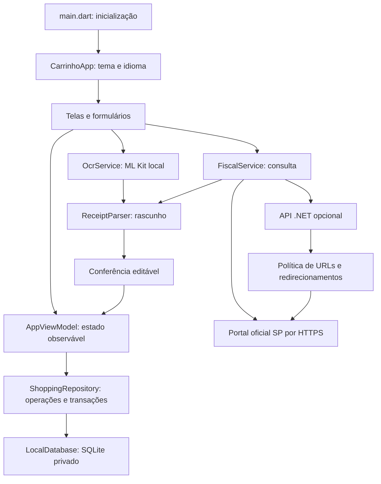

# Relatório técnico — Carrinho de Compras

Entrega desenvolvida em 18/10/2026 para Android, com Flutter/Dart, SQLite no próprio celular e backend opcional ASP.NET Core 10. A interface usa português brasileiro e o visual claro com verde apresentado na proposta.

## 1. O que foi implementado

| Recurso | Funcionamento |
|---|---|
| Listas | Criar, pesquisar, renomear, duplicar, excluir e consultar concluídas. |
| Produtos | Nome, quantidade fracionada, unidade, preço, total estimado e marcação de comprado. |
| Finalização manual | Somente itens marcados passam à conferência de uma compra. |
| Consulta fiscal | Leitura de QR code e importação de NFC-e nos portais oficiais HTTPS de SP. |
| Foto da nota | Captura pela câmera ou escolha da galeria, com OCR latino local. |
| Conferência | Corrigir estabelecimento, data, produtos, quantidade, unidade, preço e total de cada linha. |
| Associação | Uma nota pode concluir uma lista existente ou ficar somente no histórico. |
| Duplicidade | A chave fiscal única impede importar novamente a mesma NFC-e. |
| Histórico | Pesquisa por mercado ou descrição de produto, filtro mensal e detalhes de cada compra. |
| Backup | Exportação JSON pelo compartilhamento Android e restauração transacional. |
| Backend | Consulta HTTP sem banco de usuários, com limites e proteção de destinos. |
| Distribuição | APK release de teste, assinado com chave de desenvolvimento. |

O protótipo Expo já existente em `carrinho-de-compras/` foi preservado. A implementação solicitada está em `mobile/` e não depende desse protótipo.

## 2. Decisões de arquitetura

Foi adotado **MVVM leve**, inspirado nas recomendações atuais do Flutter, sem adicionar camadas sem necessidade. O estado persistente compartilhado fica em `AppViewModel`; cada formulário mantém apenas seu rascunho local até a confirmação. A composição é feita explicitamente por construtores, de modo que seja possível entender as dependências sem geradores de código ou um contêiner de injeção.



### Responsabilidade dos diretórios

- `mobile/lib/core`: conversão e apresentação de valores.
- `mobile/lib/domain`: modelos imutáveis de lista, produto e compra.
- `mobile/lib/data`: conexão SQLite, repositório, HTTP, parsers e OCR.
- `mobile/lib/ui`: telas, estado de apresentação, tema, componentes e formulários.
- `mobile/test`: regras financeiras, importação, persistência e renderização/navegação.
- `mobile/tool`: utilitário para consultar uma nota com o mesmo cliente do APK.
- `backend/Carrinho.Api/Contracts`: DTOs JSON compartilhados com o cliente.
- `backend/Carrinho.Api/Services`: política fiscal, acesso HTTP e parser HTML.
- `backend/Carrinho.Api.Tests`: testes isolados sem dependência da Sefaz.
- `scripts`: compilação em caminho sem acentos, execução da API e geração deste material.

As telas não executam SQL. O repositório é a fonte de verdade persistente. `ChangeNotifier` e `ListenableBuilder` atualizam as telas após uma gravação bem-sucedida. O estado temporário de busca, abas e formulários permanece nas respectivas telas. A integração nativa de câmera, seletor e compartilhamento é disparada a partir das telas que recebem as ações do usuário.

### Tecnologias resolvidas

Flutter 3.47.7, Dart 3.13.5 e SDK .NET 10.0.301 foram usados nesta entrega. O aplicativo Android usa SDK de compilação 36, mínimo 24 (Android 7.0), Java 21 para a ferramenta e bytecode Java/Kotlin 17. O NDK é 28.2.13676358.

As versões exatas dos pacotes Dart estão em `mobile/pubspec.lock`. Os principais são `sqflite`, `http`, `html`, `mobile_scanner`, `google_mlkit_text_recognition`, `image_picker`, `file_picker`, `share_plus`, `path_provider`, `url_launcher`, `intl` e `uuid`. No backend, o HTML é interpretado por AngleSharp 1.8.5. A fonte Roboto é distribuída localmente com sua licença Apache 2.0.

## 3. Banco de dados e vida dos dados

O arquivo `carrinho_v1.db` fica no diretório privado de bancos do Android. O app não exige login nem autorização para acessar todo o armazenamento. O SQLite não é enviado para o backend.

| Tabela | Colunas e significado |
|---|---|
| `lists` | `id` UUID; `name`; `created_at` ISO 8601; `completed` 0 ou 1. |
| `list_items` | UUID; lista; nome; quantidade em milésimos; unidade; preço em centavos; marcação; posição. |
| `purchases` | UUID; lista opcional; estabelecimento; data; chave fiscal única; total pago; origem; URL original. |
| `purchase_items` | Identidade SQLite; compra; descrição original; quantidade; unidade; preço; total original; posição. |
| `settings` | Pares chave/valor, incluindo a URL do backend opcional. |

`PRAGMA foreign_keys = ON` é aplicado a cada conexão. Excluir uma lista remove seus itens, mas as compras ligadas a ela continuam no histórico com vínculo nulo. Excluir uma compra remove suas linhas. O esquema começa na versão 1; mudanças futuras devem adicionar migrações em `onUpgrade`, sem apagar bancos existentes.

Não há tabela global de produtos: a descrição da lista e a descrição fiscal são preservadas em seus próprios registros. Assim, nomes semelhantes não são fundidos incorretamente. Um catálogo com associação por GTIN/descrição pode ser acrescentado depois, mantendo os preços históricos.

### Dinheiro, peso e arredondamento

Os cálculos financeiros usam **inteiros**. `R$ 4,79` é `479`; `1,096 kg` é `1096` milésimos de kg. O total planejado usa `(precoCentavos * quantidadeMilesimos + 500) ~/ 1000`, com arredondamento comercial para centavos. `double` aparece somente na formatação visual, nunca como armazenamento de dinheiro.

O parser de entrada separa parte inteira e fracionária, aceita vírgula brasileira e arredonda a casa excedente. Entradas negativas, inválidas ou excessivas são rejeitadas. A precisão de quantidade nesta versão é de três casas; preços por unidade são armazenados em centavos. Na importação, o **total original da linha fiscal** é preservado separadamente para não recomputar incorretamente promoções ou arredondamentos.

Se a soma das linhas diferir do total pago, a conferência mostra a diferença e pede a confirmação correspondente. Não é aplicada uma distribuição automática de descontos, pois essa regra dependeria dos detalhes da nota.

## 4. Fluxo da nota fiscal

1. `mobile_scanner` identifica o texto do QR pela câmera.
2. `ReceiptParser.validateUrl` restringe esquema, domínio, porta e caminho aos portais suportados de SP.
3. Sem backend configurado, `FiscalService` acessa a consulta diretamente pelo aparelho. Com URL configurada, envia apenas `{"url":"..."}` à API.
4. Cada redirecionamento é revalidado. O limite é de cinco destinos, dois megabytes de resposta e tempo de espera delimitado.
5. O HTML é interpretado; falhas fiscais, CAPTCHA e ausência de itens viram mensagens legíveis.
6. O usuário confere um `ReceiptDraft`, corrigindo o que for necessário.
7. `ShoppingRepository.savePurchase` verifica duplicidade e grava cabeçalho, linhas e conclusão da lista em uma transação.

O endereço completo é preservado; o aplicativo não tenta gerar ou reconstruir o hash do QR code. Uma chave isolada não substitui os parâmetros de um QR assinado. A entrada manual aceita o **endereço completo** do QR, e a consulta pode ser aberta no navegador.

### Resultado com a nota fornecida

A consulta inicialmente havia retornado “Formato de QR-Code não suportado”. Durante esta implementação foi possível acessá-la em testes integrados pelo .NET e pelo cliente Dart. Ambos reconheceram **oito linhas de produtos**, data **18/10/2026**, soma **16153 centavos** e total pago **16153 centavos**.

A página usa `.totalNumb` para vários campos, inclusive o número de itens. Por isso os parsers selecionam primeiro `#totalNota .totalNumb.txtMax`, que representa o valor a pagar. Um teste de regressão reproduz esse caso para impedir que oito itens sejam interpretados como R$ 8,00.

Essa evidência valida o documento testado naquele momento. Ela não garante disponibilidade permanente do portal nem compatibilidade com todos os documentos fiscais ou leiautes. A chave real e a foto do usuário não foram incluídas no código nem nas fixtures dos testes.

### Leitura por foto

O usuário pode fotografar a nota ou escolher uma imagem. O ML Kit latino reconhece o texto no aparelho. O serviço agrupa caixas por altura e ordena por posição horizontal para reconstruir linhas com colunas separadas. Em seguida compara essa reconstrução com o texto simples e usa a que reconhecer mais linhas de produtos.

O parser procura linhas com número, código, descrição, quantidade, unidade, preço e total. Alguns cupons exigirão correções ou inserção manual. Fotos tortas, desfocadas, dobradas ou com colunas muito afastadas podem falhar. Não se considera um produto reconhecido quando os campos essenciais estão ausentes. A tela de conferência continua disponível mesmo quando nenhum item foi identificado.

## 5. Backend ASP.NET Core 10

O backend é opcional e não tem banco. O APK entregue começa em consulta direta, portanto pode ser testado fora da rede do computador. O servidor pode ser hospedado posteriormente por quem dispõe da infraestrutura; **não foi publicado um endpoint público** nesta entrega.

| Endpoint | Contrato |
|---|---|
| `GET /health` | HTTP 200 com estado, serviço e versão. |
| `POST /api/receipts/consult` | Recebe `url`; retorna estabelecimento, chave, data, total e linhas, em camelCase. |

Quantidades são `quantityMilli`; valores são `unitPriceCents` e `totalCents`. Não há serialização ambígua de valores monetários em ponto flutuante.

O serviço utiliza `HttpClient` via DI e AngleSharp. O corpo de entrada tem limite de 8192 bytes; a consulta possui limite de 20 requisições por minuto por IP, espera de 25 segundos, limite de resposta e validação de cada redirecionamento. Domínios internos, credenciais no endereço, portas inesperadas e caminhos não suportados são rejeitados. O serviço não contorna CAPTCHA nem recebe fotos. Para implantação com proxy reverso, configurar TLS e tratamento confiável de IPs encaminhados conforme a infraestrutura escolhida.

Falhas fiscais retornam HTTP 422 com código e mensagem; timeout retorna 504; erro de rede retorna 502; excesso de chamadas retorna 429. A API de saúde permite verificar conectividade. Os serviços são stateless: nenhum histórico do usuário é mantido no servidor.

### Executar com USB

Na raiz do projeto:

```powershell
.\scripts\run-backend.ps1
adb reverse tcp:5080 tcp:5080
```

Depois selecione `http://127.0.0.1:5080` em Ajustes → Serviço de consulta. O Android precisa estar conectado e com depuração USB autorizada. Em emulador Android, `http://10.0.2.2:5080` acessa o host. Para uso remoto, configure uma URL HTTPS.

O manifesto bloqueia HTTP comum, com exceção de loopback e do endereço padrão do emulador, usados nesse teste. Não foi aberta porta no firewall. Para voltar ao modo independente, apague a URL do backend nos ajustes e salve.

O `backend/Dockerfile` possui estágio de compilação e runtime .NET 10 com usuário sem privilégios. O Dockerfile foi fornecido para implantação posterior; a execução em Docker não foi validada neste ambiente.

## 6. Backup, permissões e privacidade

A exportação gera JSON lógico com identificador de formato, versão, data, listas e compras, incluindo seus itens. Configurações de conexão não entram no backup. O seletor/compartilhamento nativo permite escolher onde guardar o arquivo. Exportar abre a interface de compartilhamento; cabe ao usuário concluir o salvamento no destino desejado.

A restauração valida a estrutura, limites e tipos antes de iniciar a substituição. Depois remove e reinsere os dados dentro de uma transação. Se uma restrição falhar, ocorre rollback e os registros anteriores continuam disponíveis. O usuário confirma expressamente a substituição no app. O limite é de 5 MB, 1000 listas, 2000 itens por lista e 10000 compras.

O backup Android automático foi desativado no manifesto para que a persistência fique explícita. O banco SQLite não é criptografado com SQLCipher nesta versão; está protegido pela área privada e pelas proteções do próprio Android. Faça exportação antes de desinstalar ou trocar de aparelho. O backup JSON também não é criptografado.

Câmera é solicitada quando o recurso nativo precisar dela. A lista funciona mesmo com câmera negada. O seletor de fotos e arquivos evita solicitar acesso amplo ao armazenamento. Não há telemetria de aplicação, login ou sincronização própria implementada. A consulta fiscal transmite a URL à Sefaz e, quando configurado, ao backend escolhido.

## 7. Compilação e APK

A pasta original contém caracteres acentuados. O Gradle recusou esse caminho no Windows e o analisador Dart também apresentou falha de comunicação nesse local. A solução foi copiar o Flutter para um diretório de compilação sem acentos, mantendo a fonte no projeto original.

`scripts/build-apk.ps1` resolve os caminhos, copia sem apagar o original, recria referências de pacotes, executa análise, testes e build release, e copia o APK e seu SHA-256 para `artifacts/`. Ele permite informar os caminhos de Flutter, Android SDK e Java por parâmetros.

```powershell
.\scripts\build-apk.ps1
```

O Flutter foi instalado em `$env:USERPROFILE\.codex\toolchains\flutter`. O SDK Android existente era somente leitura e foi copiado para `$env:USERPROFILE\.codex\toolchains\android-sdk`, onde o NDK necessário foi instalado. Nenhum diretório original de ferramentas foi apagado. O staging fica em `$env:USERPROFILE\.codex\builds\carrinho-mobile`.

O APK usa `applicationId` `br.com.carrinhodecompras.carrinho_de_compras`, versão `1.0.0+1`, código nativo release e assinatura de desenvolvimento. Isso atende à instalação direta para teste. Antes da publicação em loja, configure e proteja uma chave de produção, revise a política de backup/privacidade e valide os requisitos da loja. A chave de assinatura não integra o repositório.

O otimizador R8 é mantido. `proguard-rules.pro` contém apenas as oito supressões específicas sugeridas pelo próprio R8 para modelos OCR opcionais de chinês, devanágari, japonês e coreano. O app instancia somente o reconhecedor latino. Caso outros alfabetos sejam acrescentados, suas bibliotecas nativas também deverão ser incluídas.

Para instalar, transfira `artifacts/carrinho-de-compras-1.0.0.apk` ao Android e abra-o. O sistema pode solicitar permissão para instalar pela origem escolhida. Não é necessário instalar Flutter, Expo ou .NET no celular.

## 8. Verificação e limites dos testes

Os testes Flutter utilizam SQLite real via FFI, sem simular o armazenamento. Cobrem preços brasileiros, arredondamento por peso, oito itens do cenário sintético, validação de destinos, respostas fiscais, duplicidade, integridade referencial, restauração com rollback e fechamento/reabertura de arquivo. Um teste de widgets cobre renderização de lista, detalhes e navegação entre abas, com imagens de referência.

Os testes .NET cobrem quantidade, preço, total original, extração de chave, erro fiscal, CAPTCHA, documento indisponível, seleção do total a pagar, domínios e portas indevidos e redirecionamento bloqueado antes de um novo acesso.

Além das fixtures sintéticas, foram executadas consultas reais da nota fornecida pela API local e pelo cliente Dart. Esse teste não adicionou a compra ao banco do aplicativo. As capturas de tela de QA usam dados sintéticos e fontes empacotadas.

Nenhum Android físico estava conectado por ADB no ambiente de desenvolvimento. Portanto, permissão de câmera, foco, captura, seletor/compartilhamento e OCR nativo ainda precisam da sua validação no aparelho. Compilar um APK e passar testes de widgets não substitui esses testes físicos.

O arquivo `artifacts/VALIDACAO.md` registra o resultado final dos comandos e a identificação do binário entregue.

Resultado final: **18 testes Flutter e 13 testes .NET aprovados**, análise estática sem problemas e APK release de **105.518.040 bytes**. A assinatura v2 foi validada pelo `apksigner`; o manifesto compilado confirma Android mínimo 24 e alvo 36. O anexo linha a linha contém **60 arquivos e 5778 linhas**, com hashes conferidos contra o código-fonte.

Capturas renderizadas das telas: [Minhas listas](screenshots/listas.png) e [Lista aberta](screenshots/lista-aberta.png). São dados sintéticos de QA, não registros pessoais do usuário.

## 9. Guia para entender o código

Comece por `main.dart`, depois `ui/app.dart`, `ui/home_screen.dart`, `ui/app_view_model.dart`, `data/shopping_repository.dart` e `data/local_database.dart`. Para importação, leia `scan_screen.dart`, `fiscal_service.dart`, `receipt_parser.dart`, `ocr_service.dart` e `receipt_review_screen.dart`. O backend segue a sequência `Program.cs` → política de URL → serviço HTTP → parser → contrato.

O código possui comentários em português nas responsabilidades, decisões e operações relevantes. O complemento `LINHA_A_LINHA.md` reproduz **cada linha** dos arquivos de implementação e configuração abrangidos pela entrega, com número e explicação contextual. Dependências baixadas, binários, fontes de terceiros, caches e documentação gerada não são tratados como código autoral; o inventário identifica o escopo para que não haja confusão entre explicação do projeto e cópia de bibliotecas.

## 10. Referências primárias

- [Arquitetura recomendada pelo Flutter](https://docs.flutter.dev/app-architecture/guide).
- [Persistência SQLite no Flutter](https://docs.flutter.dev/cookbook/persistence/sqlite).
- [mobile_scanner](https://pub.dev/packages/mobile_scanner).
- [Reconhecimento de texto ML Kit para Flutter](https://pub.dev/packages/google_mlkit_text_recognition).
- [Minimal APIs no ASP.NET Core 10](https://learn.microsoft.com/en-us/aspnet/core/fundamentals/minimal-apis?view=aspnetcore-10.0).
- [Portal NFC-e de São Paulo](https://portal.fazenda.sp.gov.br/servicos/nfce).
